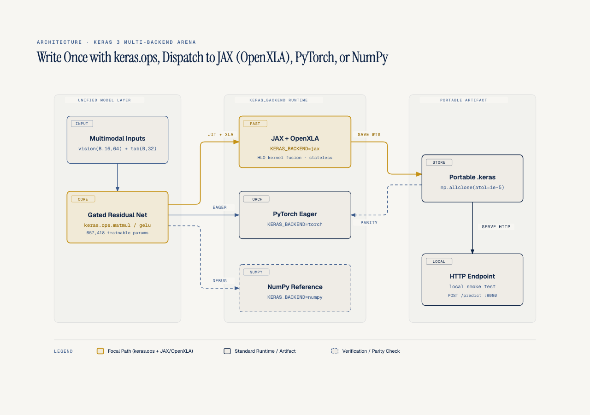
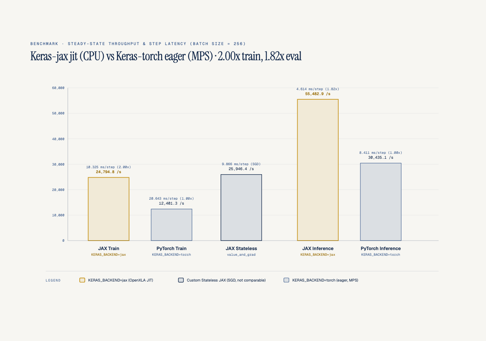
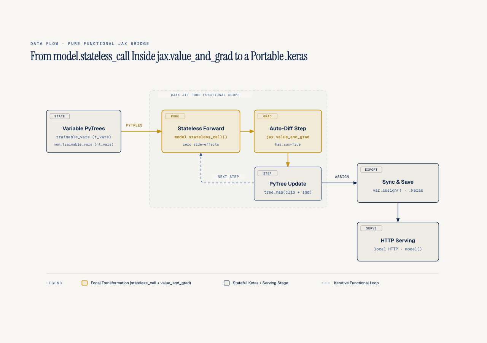

# Keras 3 Multi-Backend Arena (`keras3-multibackend-arena`)

**Por qué es relevante**: Demuestra con mediciones verificables que un mismo modelo multimodal escrito con `keras.ops` se ejecuta sin cambios sobre `jax`, `torch` y `numpy`. En esta configuración (una Mac), Keras-jax con el paso compilado en CPU dio `2.00x` el throughput de entrenamiento y `1.82x` el de inferencia de Keras-torch en eager (sin `torch.compile`, en el dispositivo por defecto de Keras, MPS). Lo que se puede atribuir a compilar, aislado en el mismo CPU, es `1.77x` en el forward (experimento 03).
**Para quién es**: Ingenieros de Machine Learning y arquitectos de sistemas de IA que buscan portabilidad entre frameworks sin sacrificar el rendimiento de compilación XLA ni la simplicidad de despliegue en contenedores ligeros.
**Quién debería verlo**: Equipos que hoy mantienen código duplicado entre PyTorch y JAX o que desean llevar modelos Keras 3 a Vertex AI (GPU NVIDIA L4) y Cloud Run con escala a cero (`--min-instances=0`). Los scripts de `gcp/` están preparados, pero este repo todavía no publica cifras de L4 ni de Cloud Run.
Parte de la serie [JAX & OpenXLA Field Guide](https://github.com/ykro/jax-openxla-field-guide).

---

## Arquitectura Multi-Backend (`keras.ops` -> JAX / PyTorch / NumPy)



El modelo `multimodal_arena_net` (`657,418` parámetros) fusiona parches visuales `(B, 16, 64)` y vectores tabulares `(B, 32)` mediante atención cruzada (`MultimodalCrossAttention`) y seis bloques residuales con compuerta `gelu(u) * sigmoid(v)` (`GatedResidualBlock`) implementados exclusivamente con primitivas de `keras.ops` (`ops.matmul`, `ops.gelu`, `ops.softmax`, `ops.rsqrt`, `ops.mean`).

---

## Resultados Reales del Juez Externo (`verify_arena.py`)



| Backend / Modo | Warmup / Compilación (ms) | Latencia Train Step (ms) | Throughput Train (samples/s) | Latencia Eval Step (ms) | Throughput Eval (samples/s) | Speedup vs PyTorch |
| :--- | ---: | ---: | ---: | ---: | ---: | ---: |
| `KERAS_BACKEND=jax` (jit, CPU) | `659.84` | `10.325` | `24,794.8` | `4.614` | `55,482.9` | **2.00x train / 1.82x eval** (distinto dispositivo) |
| `KERAS_BACKEND=torch` (eager, sin `torch.compile`, MPS por defecto) | `159.03` | `20.643` | `12,401.3` | `8.411` | `30,435.1` | `1.00x` (baseline) |
| Custom Stateless JAX (`value_and_grad`, SGD con clipping) | `373.32` | `9.866` | `25,946.4` | — | — | no comparable (otro optimizador) |

### Salida verificada de `verify_arena.py`

```text
==========================================================================================
KERAS 3 MULTI-BACKEND ARENA — OUTSIDE JUDGE VERIFICATION REPORT
==========================================================================================
Model Parameters               : 657,418
Batch Size / Steps             : 256 / 45
Cross-Backend Weight Parity    : PASS (max |JAX - Torch| = 2.98e-07, max |JAX - NumPy| = 4.17e-07)
------------------------------------------------------------------------------------------
Backend      |  Warmup (ms) | Train Step (ms) | Train (samples/s) | Eval Step (ms) | Eval (samples/s)
------------------------------------------------------------------------------------------
jax (XLA)    |       659.84 |          10.325 |           24794.8 |          4.614 |          55482.9
torch (eager) |       159.03 |          20.643 |           12401.3 |          8.411 |          30435.1
------------------------------------------------------------------------------------------
Keras-jax jit vs torch eager   : 2.00x train | 1.82x eval (torch on Keras default device)
HLO text, 'fusion' substrings  : 249 in 1026 HLO lines (forward 7.176 ms eager -> 4.065 ms jit, 1.77x)
Stateless jax.value_and_grad   : loss 2.63890 -> 0.69450 (acc 12.11% -> 91.41%, 9.866 ms/step)
Local HTTP smoke test          : status=200, model() latency=4.167 ms, artifact=7787.6 KB
==========================================================================================
```

---

## Puente Funcional: `model.stateless_call` + `jax.value_and_grad` -> `.keras`



En `experiments/04_custom_jax_train_step.py`, extraemos los PyTrees `trainable_variables` y `non_trainable_variables` de Keras 3 y ejecutamos el modelo como una transformación funcional pura dentro de `@jax.jit` y `jax.value_and_grad(has_aux=True)`. Al finalizar, los arreglos actualizados se sincronizan con `keras_var.assign(new_val)` y se exportan en un archivo `.keras` estándar de `7787.6 KB`; cerca de dos tercios de ese tamaño son el estado del optimizador AdamW (dos valores extra por parámetro).

---

## Onboarding y Cómo Ejecutar Paso a Paso

### 1. Instalación desde cero

```bash
git clone https://github.com/ykro/keras3-multibackend-arena.git
cd keras3-multibackend-arena
python3 -m venv .venv
source .venv/bin/activate
pip install --upgrade pip
pip install -e ".[dev]"
```

### 2. Recorrido guiado de los 5 experimentos

- `experiments/01_backend_agnostic_model.py` — Modelo multimodal Vision + Tabular escrito con `keras.ops` y verificado en subprocesos sobre `jax`, `torch` y `numpy`.
- `experiments/02_arena_jax_vs_torch.py` — Benchmark aislado por subprocesos midiendo compilación inicial, latencia por batch (`batch_size=256`) y samples por segundo.
- `experiments/03_xla_fusion_analysis.py` — Inspección del programa HLO compilado con OpenXLA (`1026` líneas HLO, `249` apariciones de la subcadena `fusion`, que no equivalen a fusiones, y `20` operaciones `dot`, una por matmul del modelo).
- `experiments/04_custom_jax_train_step.py` — Loop de entrenamiento en JAX puro usando `model.stateless_call`, recorte global de gradiente y `jax.tree_util.tree_map`.
- `experiments/05_export_and_serve.py` — Exportación del artefacto `.keras` y servidor HTTP local de prueba; `model(x)` corre en eager, para servir compilado conviene `model.predict` o `jax.jit` sobre `stateless_call`.

```bash
# Ejecutar cada experimento en orden
python experiments/01_backend_agnostic_model.py
python experiments/02_arena_jax_vs_torch.py
python experiments/03_xla_fusion_analysis.py
python experiments/04_custom_jax_train_step.py
python experiments/05_export_and_serve.py

# Ejecutar el Juez Externo, ruff y pytest en un solo comando
make all

# Scripts preparados (sin resultados publicados todavía) para Vertex AI (GPU NVIDIA L4) y Cloud Run (--min-instances=0)
bash gcp/run_vertex_l4_arena.sh
bash gcp/deploy_cloud_run.sh
```
